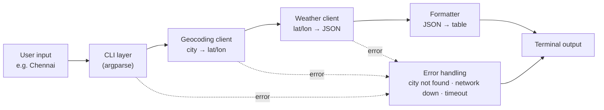

## What SkyCli does?
You type a city name and get the current weather plus a short forecast in the terminal.

```
python sky.py Chennai
python sky.py "New York" --days 3 --units imperial
```

## Data Source
[Open Meteo](https://open-meteo.com/), it's free and no API key required. So there are no secrets to manage in a public repo.
It exposes two API endpoints.

1. Geocoding API: turns a city name into latitude and longitude.
2. Forecast API: turns latitude and longitude in to weather data.

## Request Flow


## Components:
Each one has a single job, which is the main design idea here.

| Module  | Responsibility  | Takeaways   |
| -------- | --------------  | ------------  |
|`cli.py` | Parse args, validate input, call the others | argparse, subcommand-style UX |
|`geocoding.py` | Call the geocoding API, return a `Location` | requests, query params, timeouts |
|`weather.py` | Call the forecast API, return a `Forecast` | parsing JSON into typed objects |
|`models.py` | `Location`, `CurrentWeather`, `DailyForecast` dataclasses | `@dataclass`, type hints |
|`formatter.py` | Turn models into nice terminal output | rich tables (optional), weather codes → emoji|
|`errors.py` | Custom exceptions | clean error handling across layers |

## Planed Folder Layout:
```
sky_cli/
├── sky.py            # entry point
├── sky/
│   ├── __init__.py
│   ├── cli.py
│   ├── geocoding.py
│   ├── weather.py
│   ├── models.py
│   ├── formatter.py
│   └── errors.py
├── requirements.txt
└── README.md
```
