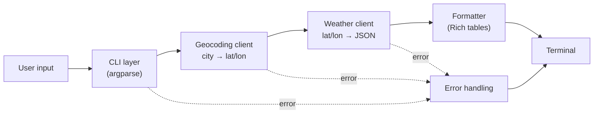

# SkyCLI ⛅

A command-line weather app: current conditions and a multi-day forecast for any city, powered by the free [Open-Meteo](https://open-meteo.com) API (no API key needed).

## Usage

```bash
pip install -r requirements.txt

python -m sky Chennai
python -m sky New York --days 5 --units imperial
python -m sky Springfield --pick
```

| Option | Description |
|---|---|
| `city` | City name (quotes optional) |
| `-d, --days` | Forecast days, 1–16 (default 3) |
| `-u, --units` | `metric` or `imperial` (default metric) |
| `-p, --pick` | Choose from all matching places |

## Design



| Module | Responsibility |
|---|---|
| `cli.py` | Parse arguments, choose a location, handle errors, print output |
| `geocoding.py` | City name → list of `Location`s |
| `weather.py` | `Location` → `Forecast` |
| `http_client.py` | Shared GET-JSON helper with timeouts and error translation |
| `models.py` | Immutable dataclasses; raw API JSON is converted here and nowhere else |
| `formatter.py` | Builds Rich panels and tables (never prints) |
| `errors.py` | `SkyError` base class and specific errors |

**Key decisions**
- Layers communicate only through typed models, never raw JSON.
- API clients never print, and the formatter never makes network calls.
- Every request has a timeout, and network failures become friendly messages.
- Ambiguous city names are resolved by the CLI, not the API layer.